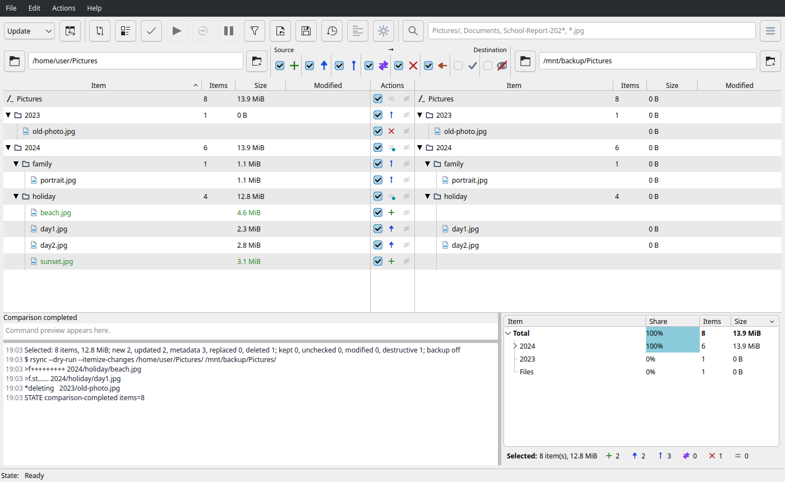
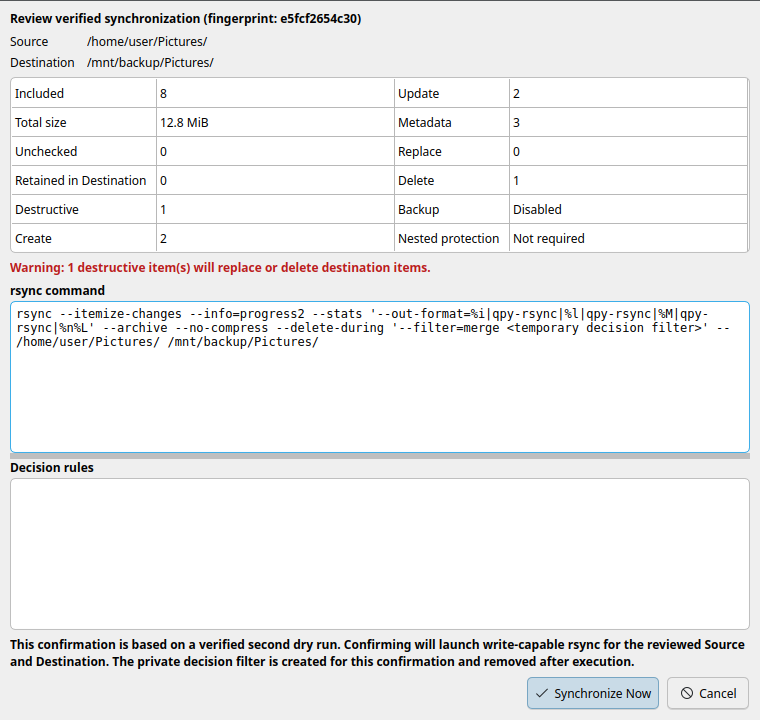
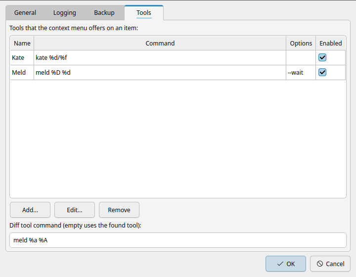

# qpy-rsync

`qpy-rsync` is a graphical frontend for `rsync` for the Linux desktop. It
compares two locations with a real `rsync --dry-run`, shows what would change
in a flat, sortable list, lets you decide item by item what to do, and only
writes after you verified and confirmed the plan. It speaks the rsync dialect
you already know, keeps every command inspectable, and never touches a file
without a preview in front of it.

The application is a visualization, configuration and control layer. It does
not implement its own transfer engine: the preview and the synchronization
always run the same `rsync` with equivalent options.



## What it does

- compares a local folder with another local folder, or with one folder on a
  remote host over SSH
- shows the source, the action and the destination of every item in one flat
  list, with the folders painted as a hierarchy
- lets you include or exclude items, whole folders or a whole comparison
- stashes items for the duration of one comparison, and folds folders away
  while you read a large tree
- keeps one ordered list of rsync include and exclude rules, with a live
  preview of the command
- takes a backup of everything it changes, in a directory you choose
- verifies the selection with a second dry run and asks for an explicit
  confirmation before it writes anything
- reports the progress, keeps a journal of every command, and logs the raw
  rsync output in a session file
- opens an item in an external diff tool, or in any external tool you
  configure

## Using it

### 1. Enter the two locations

Both fields accept the same syntax:

```text
/home/alice/data          a local folder
~/data                    a local folder, ~ is expanded
server:/srv/data          a folder on a remote host
alice@server:/srv/data    a folder on a remote host, with a user
```

At most one side may be remote. `Host` aliases from `~/.ssh/config` work as
they do for `rsync`. Press **Enter** in the destination field to start the
comparison when both sides are filled in.

### 2. Choose the method

| Method | Behaviour |
|---|---|
| **Update** | copies new and changed items, keeps what only exists in the destination |
| **Mirror** | makes the destination match the source, deleting the items that only exist there |
| **New Only** | copies only the items that are missing in the destination |

### 3. Compare

**Compare** (F5) runs `rsync --dry-run`. The list fills with the items that
rsync reported, grouped by folder. The three panes stay synchronized: the
source on the left, the action in the middle, the destination on the right.

The action pane carries a checkbox for every item that can be decided.
Checking an item includes it in the synchronization, unchecking it excludes
it. A folder decides for everything below it, and a child can override its
folder.

### 4. Filter, fold and stash

The filter field above the panes matches the names of the items, or their
relative path when the pattern contains a slash. Shell-style globs work
(`*.jpg`, `file?.txt`, `[0-9]*`). A pattern that ends with a slash matches
folders only.

The branch marker in front of a folder folds its contents out of the list.
Folding is a view-only operation: the synchronization, the totals and the
overview keep every item.

**Space** stashes the selected item. A stashed item is left out of the
synchronization, stays in the comparison so that you can restore it, and is
forgotten with the next comparison. The crossed-eye marker in the action
column stashes and restores an item, the *Show stashed items* toggle in the
filter bar reveals them, and its right-click menu offers *Restore All
Stashed*.

The checkboxes above the panes filter the list by action. A plain click
toggles one action, **Ctrl+click** inverts the bar so that only the clicked
action is shown, and the right-click menu of a checkbox offers *Show only
this*, *Show everything but this*, *Show all* and *Reset to default*.

### 5. Verify and synchronize

**Validate Actions** (F8) builds an immutable plan of your selection and runs
a second dry run with it. If the result differs from what you see, the
execution is blocked and the difference is reported.

**Synchronize** (F9) then opens the confirmation dialog with the endpoints,
the counts, the destructive operations and the backup configuration. Only
after you confirm, a write-capable `rsync` runs with the verified plan.



### Filters, backups and profiles

- **Filters** (F7) maintains the ordered include and exclude rules. The first
  matching rsync rule wins, and the rules apply to the comparison and to the
  execution.
- The **backup directory** turns on rsync's `--backup` for everything that is
  changed or removed on the destination. When the backup folder lies inside
  the compared tree, it is protected automatically.
- **Save Profile** (F2) and **Load Profile** (F3) store the endpoints, the
  method, the rules and the backup settings.

### External tools

The settings have a *Tools* page that lists the tools the context menu of a
row offers. A tool is a command with placeholders:

| Placeholder | Meaning |
|---|---|
| `%a` | the full path of the item in the pane you clicked |
| `%f` | its file name, `%x` its extension, `%b` the name without it |
| `%d` | its directory |
| `%A` | the full path of the item in the other pane |
| `%F` | its file name, `%X` its extension, `%B` the name without it |
| `%D` | its directory |
| `%R` `%U` `%V` `%W` `%P` | the host, the user, `@`, `:` and `://` of the other pane |
| `%T` `%O` | the name and the options of the tool |
| `%%` | a literal percent |

```text
kate %d/%f
meld %D %d
scp %d/%f %U%V%R%W%D/%F
```

The same page holds the command of the diff tool. An empty field keeps the
tool that the system offers, with the preference of Git.



### Keyboard

| Key | Action |
|---|---|
| F1 | the how-to |
| F2 / F3 | save and load a profile |
| F4 | focus the method |
| F5 / F6 / F7 | compare, inventory, filters |
| F8 / F9 | validate the actions, synchronize |
| F10 / F11 | cancel a running operation, pause it |
| Ctrl+F | focus the filter field |
| Ctrl+, | the settings |
| Ctrl+Z | reset every manual decision |
| Space | stash the selected item |
| Left / Right | fold and unfold a folder |
| Ctrl+click | invert the action filter |
| Ctrl+Q | quit |

## Requirements

- Python 3.11 or newer
- rsync 3.x
- OpenSSH for the remote endpoints
- PySide6 6.7 or newer for the interface
- an askpass helper (`ksshaskpass`) for the password prompts of a remote host

## Installation

The runtime packages, the optional virtual environment, the development
packages and the SSH prerequisites are described in
[`docs/installation.md`](docs/installation.md).

The short version, with the system Python of Ubuntu:

```bash
./qpy-rsync.sh
```

The runners resolve the checkout themselves and work from any directory.
`./qpy-rsync-test.sh -q` runs the whole test suite, compiles the sources and
checks the diff.

## Development and debugging

- [`docs/installation.md`](docs/installation.md) — the runtime, the
  development packages and the test commands
- [`docs/debugging.md`](docs/debugging.md) — the console diagnostics of a run

## Documentation

| Document | Content |
|---|---|
| [`docs/design.md`](docs/design.md) | the design, the architecture and the specifications |
| [`docs/roadmap.md`](docs/roadmap.md) | the milestones, their validation and the plan |
| [`docs/installation.md`](docs/installation.md) | the installation, the development setup and the SSH prerequisites |
| [`docs/debugging.md`](docs/debugging.md) | the diagnostics of a run |
| [`CHANGELOG.md`](CHANGELOG.md) | the history of every change |

## Safety status

This is pre-alpha software. The synchronization is implemented and validated,
but the execution stays restricted to disposable local paths under
`/tmp/qpy-rsync-smoke` while the cancellation and the failure handling mature.
The verification dry run and the explicit confirmation stand between a
comparison and a write, and the application never runs a command through a
shell.

## License

GPL-3.0-or-later. See [`LICENSE`](LICENSE).
